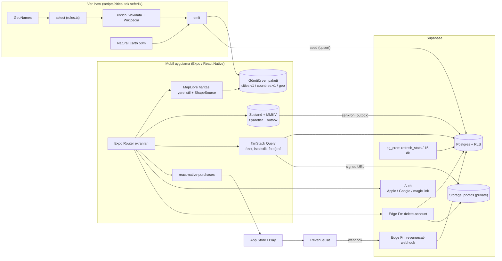
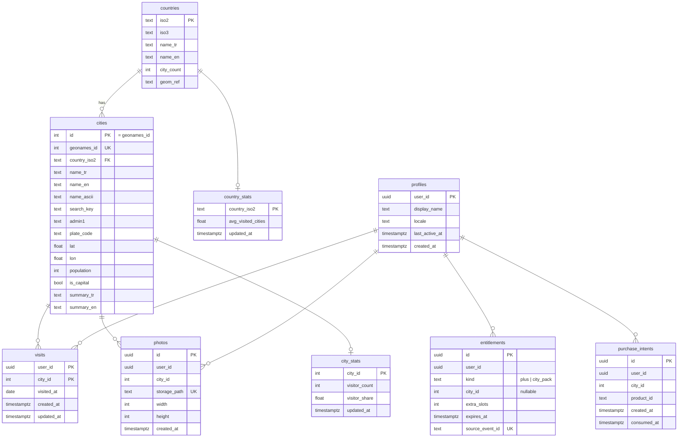
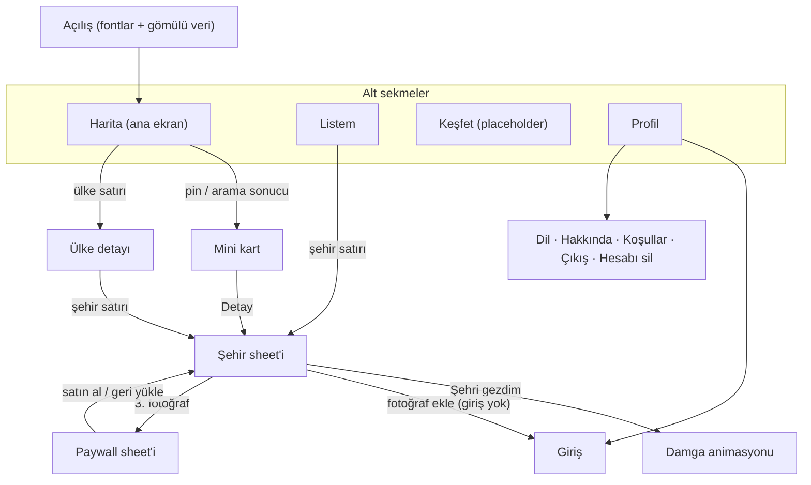

# Stampa — MVP Planı

Gezi takip uygulaması: haritadan şehir seç, "Şehri gezdim" de, dünyanın yüzde kaçını gezdiğini gör.
Kaynak görev tanımı: [`stampa-claude-code-prompt.md`](../stampa-claude-code-prompt.md). Kararlar: [`DECISIONS.md`](DECISIONS.md). Elle yapılacaklar: [`TODO-MANUAL.md`](TODO-MANUAL.md).

## 1. Mimari

## 2. Veri modeli

**RLS deseni:** referans tabloları (`countries`, `cities`) herkese `SELECT`. Kullanıcı tabloları `user_id = auth.uid()`. `entitlements` istemciden yalnızca okunur (yazma: service role). İstatistik ham tabloları istemciye kapalı; `city_stats_public` / `country_stats_public` view'ları k-anonimlik eşiğini uygular. v2'deki `ratings` / `comments` aynı deseni (`user_id` + `city_id` FK, sahibine yazma, toplu veriye view) izleyecek.

**Fonksiyonlar:** `photo_quota(user, city)`, `can_upload_photo(user, city)`, `refresh_stats()`, `touch_last_active()`, `sync_visits(jsonb)`.

## 3. Ekran akışı

## 4. Milestone'lar

### M0 — Planlama
**Amaç:** Kapsamı, mimariyi ve kararları sabitlemek.
- [x] `docs/PLAN.md` (mimari, veri modeli, ekran akışı, milestone'lar)
- [x] `docs/DECISIONS.md`
- [x] `docs/TODO-MANUAL.md`

**Kabul:** Üç doküman repoda; milestone'ların her biri amaç/görev/kabul/risk içeriyor.
**Riskler:** Paydanın (şehir tanımı) sonradan değişmesi yüzdeleri bozar → §3 kuralları DECISIONS'ta sabit.

### M1 — İskelet
**Amaç:** Çalışan, test edilebilir boş uygulama ve kalite hattı.
- [x] pnpm workspace, ortak tsconfig, ESLint + Prettier
- [x] `apps/mobile` Expo uygulaması (Expo Router, dev client)
- [x] `packages/shared` (saf TS yardımcılar)
- [x] `theme/tokens.ts`, Space Grotesk + Inter fontları
- [x] i18n (tr/en, cihaz dili varsayılan)
- [x] 4 sekmeli navigasyon (Harita / Listem / Keşfet / Profil)
- [x] Jest + RNTL, Vitest; GitHub Actions CI

**Kabul:** `pnpm lint && pnpm typecheck && pnpm test` temiz; iOS JS bundle derleniyor (`expo export`). Simülatörde açılış, tüm native modüller eklendikten sonra M3'te doğrulanır.
**Riskler:** pnpm + Metro çözümleme sorunları → `node-linker=hoisted`.

### M2 — Şehir veri hattı
**Amaç:** Paydayı belirleyen şehir setini üretmek, uygulamaya gömmek, DB'ye seed etmek.
- [x] GeoNames indirme (cities15000, TR, countryInfo, admin1, alternateNames)
- [x] `rules.ts`: varsayılan ≥100k + başkent; TR = 81 il; override edilebilir
- [x] Wikidata açıklamaları + Wikipedia özetleri (cache'li, devam ettirilebilir)
- [x] Natural Earth 50m ülke geometrisi (sadeleştirilmiş)
- [x] Gömülü paket (`cities.v1.json`, `countries.v1.json`, `countries.geo.json`)
- [x] Supabase migration'ları (referans tabloları) + idempotent seed
- [x] Testler: TR = 81, kural override, idempotentlik

**Kabul:** Hat gerçek veriyle çalışıyor (5.916 şehir, 244 ülke); TR tam 81; hat ve seed iki kez çalıştırılınca sonuç aynı.
**Riskler:** GeoNames'te eksik/yanlış PPLA kayıtları → test + elle düzeltme tablosu. Wikipedia hız sınırı → cache + düşük eşzamanlılık; özet yoksa yedek metin.

### M3 — Harita ve seçim
**Amaç:** Haritada şehir bulup seçebilmek.
- [x] MapLibre haritası, yerel stil, ülke dolguları
- [x] Native cluster'lı şehir pinleri (ShapeSource), +/− zoom
- [x] Arama (aksan / Türkçe karakter duyarsız)
- [x] Mini kart + şehir sheet'i (yerel veri)

**Kabul:** ~5–8 bin pin akıcı; "istanbul" → İstanbul, "sao paulo" → São Paulo; sonuca dokununca harita gidiyor ve kart açılıyor.
**Riskler:** MapLibre RN API değişiklikleri → sürüm sabitleme; Expo Go'da çalışmaz → dev build.

### M4 — Ziyaretler ve sayaçlar
**Amaç:** Damgalama ve tüm sayaçlar yerelde çalışsın.
- [x] MMKV kalıcı ziyaret store'u
- [x] Dünya sayacı, ülke sayaçları, "Ülkelerin" listesi
- [x] Ülke detay ekranı (halka grafik, filtreler)
- [x] Listem (ülkeye göre gruplu, tarihe göre sıralı)
- [x] Damga rozeti + animasyon + haptic
- [x] Türkçe sayı formatı

**Kabul:** Damgalayınca sayaçlar anında güncelleniyor; TR 81 üzerinden hesaplanıyor (test); uygulama yeniden açılınca veriler duruyor.
**Riskler:** Her damgada tüm pin kaynağının yeniden üretilmesi → memoize + yalnızca `visited` kümesine bağlı ifade.

### M5 — Auth ve senkronizasyon
**Amaç:** Hesap ve cihazlar arası veri.
- [x] Supabase client + oturum kalıcılığı
- [x] Apple, Google, magic link girişleri
- [x] Misafir verisini hesaba taşıma
- [x] Offline outbox + yeniden deneme
- [x] Kullanıcı tabloları migration'ı + pgTAP RLS testleri

**Kabul:** Uçak modunda damgalama → bağlantı gelince senkron; kullanıcı başkasının verisini okuyamıyor/yazamıyor (test).
**Riskler:** Sağlayıcı yapılandırmaları hesap gerektirir → TODO-MANUAL; yerelde e-posta girişi ile doğrulama.

### M6 — Fotoğraflar
**Amaç:** Şehir başına fotoğraf, kota sunucuda.
- [x] Seçme + sıkıştırma (uzun kenar 2048, kalite 0.8)
- [x] Yükleme, signed URL, `expo-image` cache, grid
- [x] `photo_quota` / `can_upload_photo` + Storage policy
- [x] pgTAP: 3. yükleme reddi

**Kabul:** 3. fotoğraf denemesi paywall açıyor; istemci atlatılsa da sunucu reddediyor (test).
**Riskler:** Eşzamanlı yüklemede yarış → advisory lock.

### M7 — IAP
**Amaç:** Şehir paketi ve Plus satın alımı kotaya yansısın.
- [x] RevenueCat SDK, offering'lerden fiyat
- [x] Paywall sheet'i
- [x] `purchase_intents` + webhook Edge Function (idempotent)
- [x] Geri yükleme
- [x] Testler: webhook işleyici, entitlement → kota

**Kabul:** Webhook olayı entitlement yazıyor ve kota artıyor (test). Sandbox satın alma: manuel doğrulama.
**Riskler:** Şehir paketi ürün tipi (bkz. DECISIONS D7); webhook gecikmesi → satın alma sonrası kısa süreli yoklama.

### M8 — Topluluk istatistikleri
**Amaç:** "Kullanıcıların %X'i gezdi".
- [x] `city_stats` / `country_stats` + `refresh_stats()`
- [x] pg_cron (15 dk)
- [x] k-anonim view'lar + pgTAP
- [x] Şehir sheet'i ve ülke detayına bağlama

**Kabul:** Yüzde gerçek veriden; ziyaretçi < 20 ise "Yeni keşif" (test).
**Riskler:** Az kullanıcıda her şey "Yeni keşif" görünür — beklenen davranış.

### M9 — Cila ve yayın hazırlığı
**Amaç:** Mağazaya gönderilebilir duruma getirmek.
- [x] Hesap silme (Edge Function + UI)
- [x] Boş / hata / yükleniyor durumları
- [x] Erişilebilirlik turu
- [x] Uygulama ikonu + splash
- [x] EAS build profilleri
- [x] Store metinleri (tr/en) + gizlilik etiketleri taslağı
- [x] Hakkında ekranı (veri atıfları)

**Kabul:** §5'teki MVP kriterleri; yerelde doğrulanamayanlar açıkça işaretli.
**Riskler:** Store incelemesi (hesap silme, restore, gizlilik) → taslaklar hazır.

## 5. MVP kabul kriterleri

İşaretli olanlar bu makinede doğrulandı. İşaretsiz olanların kodu hazır, ama doğrulaması hesap/cihaz gerektiriyor (bkz. `TODO-MANUAL.md`).

- [x] "Şehri gezdim" ile damgalama; dünya ve ülke sayaçları anında güncelleniyor. — *Birim/bileşen testleri (store, `WorldCounter`). Simülatörde ana ekran çalışır durumda görüldü; dokunma etkileşimi simülatörde otomatik denenemedi.*
- [x] Türkiye sayacı 81 il üzerinden doğru. — *Veri hattı, gömülü paket ve veritabanı testleri.*
- [x] Uçak modunda işaretleme; bağlantı gelince senkron. — *Senkron motoru testleri (başarısız istek → kuyruk korunur → sonraki denemede gönderilir) + gerçek `sync_visits` RPC'si (pgTAP ve e2e). Cihazda uçak moduyla elle denenmedi.*
- [x] 3. fotoğraf paywall açıyor; sunucu 3. yüklemeyi reddediyor. — *pgTAP + gerçek Storage API üzerinden e2e. Paywall'ın açılması istemci mantığı testiyle (`canAddPhoto`), ekranın kendisi elle denenmedi.*
- [ ] Sandbox'ta Şehir paketi ve Plus alınabiliyor, geri yüklenebiliyor. — *Webhook → entitlement → kota zinciri pgTAP ve e2e ile doğrulandı; mağaza sandbox satın alması RevenueCat/App Store/Play hesapları gerektiriyor.*
- [x] Topluluk yüzdesi gerçek veriden; k-anonimlik eşiğine uyuyor. — *pgTAP (20 ziyaretçi gösterilir, 19 gizlenir; ham sayılar API'ye kapalı).*
- [x] Hesap silme tüm veriyi ve fotoğrafları kaldırıyor. — *Yerel stack üzerinde `delete-account` Edge Function'ı ile e2e.*
- [x] `pnpm lint && pnpm typecheck && pnpm test` temiz; CI yeşil. — *Yerelde temiz; GitHub Actions `b1d09d6` commit'inde başarılı (lint, typecheck, testler ve pgTAP).*
- [ ] iOS ve Android için EAS development build. — *iOS simülatör build'i yerelde `xcodebuild` ile alındı ve uygulama açıldı. EAS build (hesap) ve Android (bu makinede JDK/SDK yok) denenmedi.*

## 6. Bilinen sınırlar

- Şehirlerin %88'i Wikidata ile eşleşti (5.187 / 5.916). Türkçe özet 3.091, İngilizce özet 4.766 şehirde var; kalanlar "Ülke · Bölge · Nüfus" yedek metnini gösterir. Eşleşmeyenlerde Türkçe ad yerine GeoNames adı kullanılır (D19).
- Türkiye'de şehirler il adıyla gösterilir, özet metni ise il merkezinin Wikipedia maddesinden gelir (ör. Kocaeli kaydında İzmit özeti).
- MapTiler anahtarı olmadan haritada yazı yok (D17).
- Performans hedefleri (60 fps, 2 sn soğuk açılış) ölçülmedi; mimari bu hedeflere göre kuruldu (native cluster, gömülü veri, senkron MMKV).
- `expo run:ios` bu makinede simülatör için de imzalama sertifikası istedi; simülatör build'i `xcodebuild` ile alındı.
